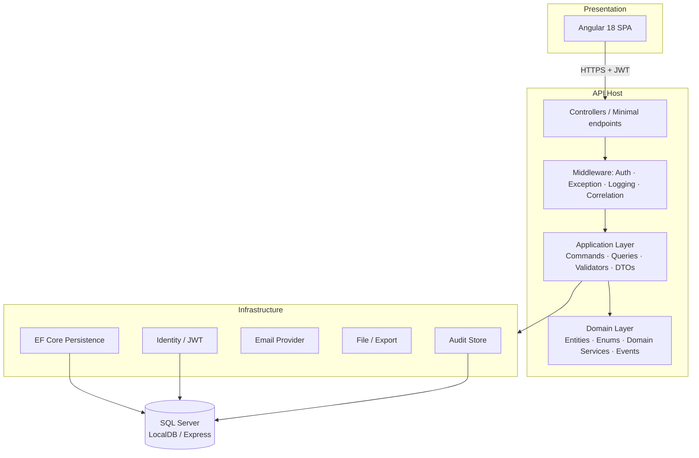
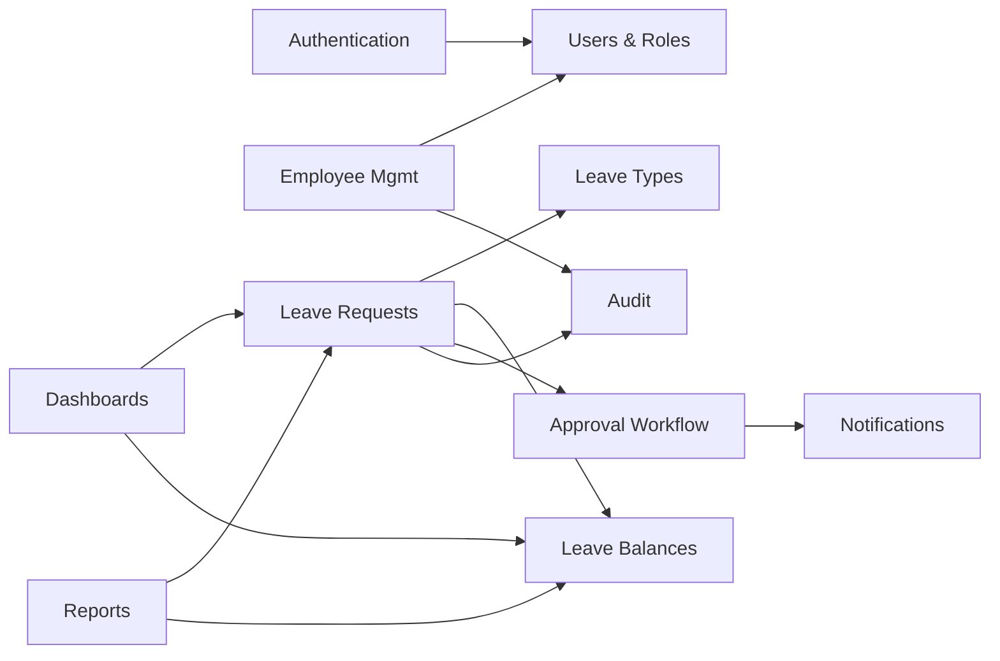
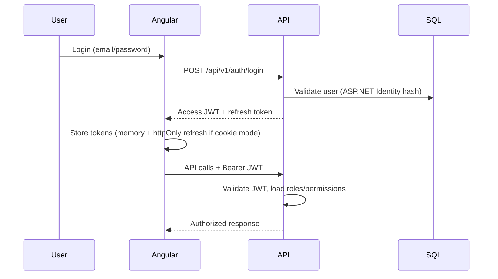
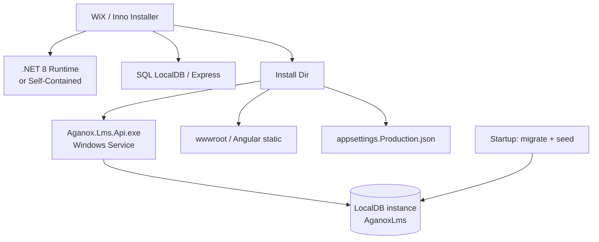

# Solution Architecture — Enterprise Leave Management System (Aganox LMS)

**Version:** 1.0  
**Status:** Awaiting approval  
**Stack:** ASP.NET Core 8 · EF Core 8 · SQL Server · Angular 18 · Bootstrap 5

---

## 1. Executive Summary

Aganox LMS replaces Excel/Access leave registers with a deployable Windows application: a self-hosted ASP.NET Core API, Angular SPA, and SQL Server LocalDB/Express. Clean Architecture keeps domain rules independent of UI and infrastructure so the product can later move to Azure SQL, Docker, or multi-tenant SaaS without rewriting core leave logic.

---

## 2. Architecture Style

| Decision | Choice | Rationale |
|----------|--------|-----------|
| Overall style | Clean Architecture + modular monolith | SME-friendly deploy; clear boundaries for later split |
| Frontend | Angular 18 SPA + Bootstrap 5 | Preferred stack; strong typing; enterprise tooling |
| API | REST + JWT, versioned (`/api/v1`) | Simple clients, Swagger-first contract |
| Patterns | CQRS (MediatR) for writes/reads that diverge; Repository only for complex aggregates | Avoid ceremony where EF DbContext is enough |
| AuthZ | Role + permission claims | Admin / HR / Manager / Employee with configurable permissions |
| Hosting (v1) | Windows service or Kestrel behind IIS + LocalDB | One-click installer on Win10/11 |

---

## 3. Logical View

### Layer responsibilities

| Layer | Project | Responsibility |
|-------|---------|----------------|
| **Domain** | `Aganox.Lms.Domain` | Entities, value objects, enums, domain services (leave day calculation, overlap rules), domain events. No EF/UI refs. |
| **Application** | `Aganox.Lms.Application` | Use cases (CQRS handlers), DTOs, FluentValidation, interfaces (ports), AutoMapper profiles. |
| **Infrastructure** | `Aganox.Lms.Infrastructure` | EF Core, Identity, JWT, email, Excel/PDF export, backup helpers, Serilog sinks. |
| **Persistence** | *(inside Infrastructure or `Aganox.Lms.Persistence`)* | `DbContext`, configurations, migrations, seed. Prefer separate project for clarity. |
| **API** | `Aganox.Lms.Api` | Controllers, middleware, DI composition, Swagger, health checks. |
| **UI** | `aganox-lms-web` | Angular modules: Auth, Employees, Leave, Approvals, Reports, Admin. |
| **Installer** | `Aganox.Lms.Installer` | WiX / Inno Setup package. |

---

## 4. High-Level Design (Modules)

### Cross-cutting concerns

- **Global exception middleware** → ProblemDetails (`RFC 7807`)
- **Serilog** → console + rolling file + optional Seq
- **Correlation ID** on every request
- **Soft delete** + full audit columns on mutable entities
- **FluentValidation** before handlers
- **Rate limiting** on auth endpoints
- **Health checks**: DB, disk, self

---

## 5. Security Architecture

| Concern | Approach |
|---------|----------|
| Passwords | ASP.NET Core Identity (PBKDF2 / configured hasher) |
| Tokens | Short-lived JWT access (15–60 min) + refresh token rotation |
| Roles | Administrator, HR, Manager, Employee |
| Permissions | Claim-based (`Permission:Employees.View`, etc.); roles map to permission sets |
| Transport | HTTPS (dev cert / installer-generated or IIS binding) |
| Secrets | `appsettings` + User Secrets (dev); DPAPI/env for production install |

---

## 6. Leave Domain — Core Rules (LLD preview)

| Rule | Behavior |
|------|----------|
| Day count | Inclusive date range; optional half-day = 0.5 |
| Weekends | Skip Sat/Sun when `LeavePolicy.SkipWeekends = true` |
| Holidays | Skip dates in `Holidays` for org calendar year |
| Overlap | Reject if pending/approved leave intersects same employee |
| Balance | Reject submit/approve if remaining < requested days (type-specific) |
| Workflow | Employee → Manager → HR → Approved (configurable skip of HR for short leave later) |
| Edit | Approved leave edits reset to Pending and require re-approval |
| Cancel | Employee can cancel Draft/Pending; Approved cancel may need Manager/HR |

Domain services (not anemic entities):

- `ILeaveDayCalculator`
- `ILeaveOverlapChecker`
- `ILeaveBalanceGuard`
- `IApprovalWorkflowEngine`

---

## 7. Deployment Architecture (Windows SME)

**First-run:** create DB, apply EF migrations, seed roles, default leave types, admin account (credentials collected by installer or default + force change password).

---

## 8. Scalability Path (non-goals for v1, designed-in)

| Horizon | Change |
|---------|--------|
| Scale-up | SQL Server Express → Standard/Enterprise or Azure SQL (connection string only) |
| Containers | Docker Compose (API + SQL); later K8s |
| Auth | LDAP / AD / SSO (OpenID Connect) behind `IExternalAuthProvider` |
| Multi-tenant | `TenantId` column + query filters (schema reserved, not enabled) |
| Mobile | Same REST API |
| Messaging | Domain events → outbox → Teams/Slack/SMS adapters |

---

## 9. Non-Functional Targets

| NFR | Target |
|-----|--------|
| Concurrent users | 50–200 (SME) |
| API p95 | < 300 ms for list endpoints (paged) |
| Availability | Single-node; backup/restore for DR |
| Audit | Immutable activity log + entity soft-delete |
| Accessibility | WCAG 2.1 AA where practical (Bootstrap + semantic HTML) |

---

## 10. Technology Decision Record (summary)

1. **Angular over React** — plan preference; consistent enterprise SPA patterns.  
2. **MediatR CQRS** — clear use-case boundary; optional for trivial CRUD.  
3. **Persistence as separate project** — migrations isolated from email/JWT infra.  
4. **LocalDB default, Express optional** — zero-admin DB for desktop install.  
5. **WiX preferred** — MSI + upgrade/uninstall; Inno as fallback if WiX cost/complexity bites.

---

## Approval checkpoint

Approve this architecture (or note changes) before database schema freeze and coding.
