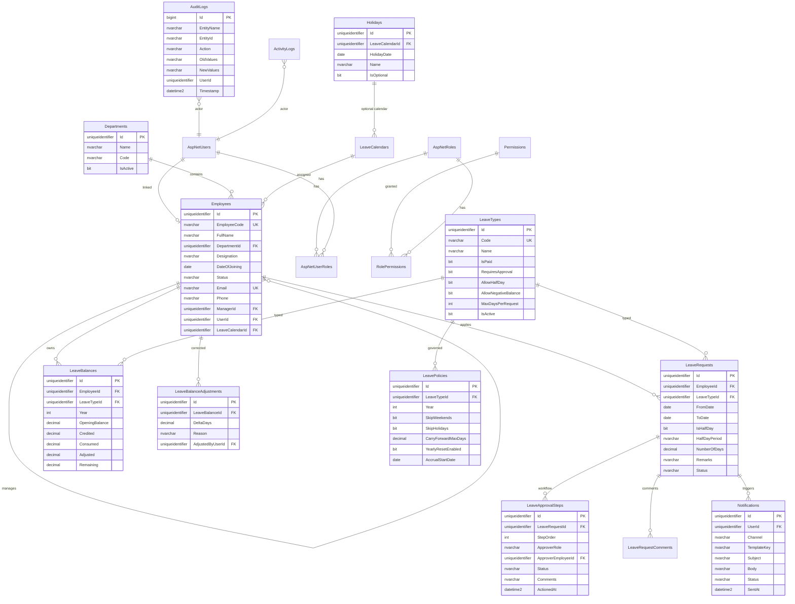

# Database Design — Aganox LMS

**Version:** 1.0  
**RDBMS:** SQL Server LocalDB / Express (compatible with Azure SQL)  
**ORM:** Entity Framework Core 8 (Code-First + Migrations)

---

## 1. Design Principles

- 3NF where practical; controlled denormalization only for reporting snapshots if needed later
- Soft delete (`IsDeleted`, `DeletedAt`, `DeletedBy`) on business entities
- Audit columns on all mutable tables: `CreatedAt`, `CreatedBy`, `ModifiedAt`, `ModifiedBy`
- Money/balance as `decimal(9,2)` for leave days
- UTC timestamps in DB; UI converts to local
- Indexes on FKs, status filters, and date ranges used by dashboards

---

## 2. ER Diagram

---

## 3. Table Catalog

### 3.1 Identity (ASP.NET Identity — customized)

| Table | Purpose |
|-------|---------|
| `AspNetUsers` | Login identity; linked 1:1 to `Employees` when applicable |
| `AspNetRoles` | Administrator, HR, Manager, Employee |
| `AspNetUserRoles` | User ↔ role |
| `AspNetRoleClaims` / `AspNetUserClaims` | Permission claims |
| `RefreshTokens` | Rotating refresh tokens |

### 3.2 Organization

#### `Departments`
| Column | Type | Notes |
|--------|------|-------|
| Id | uniqueidentifier | PK |
| Name | nvarchar(100) | Required |
| Code | nvarchar(20) | UK |
| IsActive | bit | Default 1 |
| Audit + soft delete | | |

#### `Employees`
| Column | Type | Notes |
|--------|------|-------|
| Id | uniqueidentifier | PK |
| EmployeeCode | nvarchar(30) | UK, business “Employee ID” |
| FullName | nvarchar(200) | |
| DepartmentId | uniqueidentifier | FK |
| Designation | nvarchar(100) | |
| DateOfJoining | date | |
| Status | nvarchar(20) | Active / Inactive / Terminated |
| Email | nvarchar(256) | UK |
| Phone | nvarchar(30) | |
| ManagerId | uniqueidentifier | FK self, nullable |
| UserId | uniqueidentifier | FK AspNetUsers, nullable until account created |
| LeaveCalendarId | uniqueidentifier | FK, default org calendar |

Indexes: `(DepartmentId)`, `(ManagerId)`, `(Status)`, `(FullName)`

### 3.3 Leave configuration

#### `LeaveTypes`
| Column | Type | Notes |
|--------|------|-------|
| Code | nvarchar(30) | EL, SL, COMP — UK |
| Name | nvarchar(100) | |
| IsPaid | bit | |
| RequiresApproval | bit | |
| AllowHalfDay | bit | |
| AllowNegativeBalance | bit | Default 0 |
| MaxDaysPerRequest | int | Nullable = unlimited |
| ColorHex | nvarchar(7) | UI calendar |
| SortOrder | int | |
| IsActive | bit | Soft-configurable from UI |

#### `LeavePolicies` (per type per year)
| Column | Type | Notes |
|--------|------|-------|
| LeaveTypeId | FK | |
| Year | int | |
| SkipWeekends | bit | Default 1 |
| SkipHolidays | bit | Default 1 |
| CarryForwardMaxDays | decimal(9,2) | 0 = none |
| YearlyResetEnabled | bit | |
| DefaultOpeningBalance | decimal(9,2) | Seed helper |

UK: `(LeaveTypeId, Year)`

#### `LeaveCalendars` / `Holidays`
Org or location calendars; holidays drive day calculator.

### 3.4 Leave runtime

#### `LeaveBalances`
| Column | Type | Notes |
|--------|------|-------|
| EmployeeId, LeaveTypeId, Year | | UK composite |
| OpeningBalance | decimal(9,2) | |
| Credited | decimal(9,2) | Accruals / CF in |
| Consumed | decimal(9,2) | Approved usage |
| Adjusted | decimal(9,2) | HR manual sum |
| Remaining | decimal(9,2) | Computed persisted: Opening+Credited+Adjusted−Consumed |

Check: `Remaining >= 0` unless type allows negative (enforced in app; optional DB check).

#### `LeaveBalanceAdjustments`
Append-only HR corrections with reason; updates `LeaveBalances.Adjusted` / `Remaining`.

#### `LeaveRequests`
| Column | Type | Notes |
|--------|------|-------|
| Status | nvarchar(20) | Draft, Pending, Approved, Rejected, Cancelled |
| FromDate / ToDate | date | From ≤ To |
| IsHalfDay | bit | If true, From=To |
| HalfDayPeriod | nvarchar(10) | AM/PM nullable |
| NumberOfDays | decimal(9,2) | System-calculated |
| RowVersion | rowversion | Concurrency |

Indexes: `(EmployeeId, Status)`, `(FromDate, ToDate)`, `(Status)`

#### `LeaveApprovalSteps`
| Column | Type | Notes |
|--------|------|-------|
| StepOrder | int | 1=Manager, 2=HR |
| ApproverRole | nvarchar(30) | |
| ApproverEmployeeId | uniqueidentifier | Resolved at submit time |
| Status | nvarchar(20) | Pending, Approved, Rejected, Skipped |
| Comments | nvarchar(1000) | |
| ActionedAt | datetime2 | |

#### `LeaveRequestComments`
General discussion thread (optional vs step comments).

### 3.5 Notifications & audit

| Table | Purpose |
|-------|---------|
| `Notifications` | Outbox for email (and future SMS/Teams) |
| `NotificationTemplates` | Subject/body templates by key |
| `AuditLogs` | EF interceptor / SaveChanges diffs |
| `ActivityLogs` | High-level user actions for admin UI |
| `AppSettings` | Key-value runtime config |

### 3.6 Backup metadata

| Table | Purpose |
|-------|---------|
| `BackupHistory` | Path, timestamp, status, initiated by |

---

## 4. Relationships Summary

| From | To | Cardinality | On delete |
|------|----|-------------|-----------|
| Department | Employee | 1:N | Restrict |
| Employee | Employee (Manager) | 1:N | Set null |
| Employee | LeaveRequest | 1:N | Restrict |
| LeaveType | LeaveRequest | 1:N | Restrict |
| LeaveRequest | LeaveApprovalStep | 1:N | Cascade |
| Employee + LeaveType + Year | LeaveBalance | 1:1 | Cascade on employee soft-delete policy: Restrict |

---

## 5. Seed Data

| Seed | Values |
|------|--------|
| Roles | Administrator, HR, Manager, Employee |
| Permissions | Full matrix (see API design) |
| Leave types | Earned Leave (EL), Sick Leave (SL), Compensatory Leave (COMP) |
| Policies | Current year; SkipWeekends=true; SkipHolidays=true |
| Calendar | Default + sample national holidays (configurable) |
| Admin user | From installer; role Administrator; force password change flag |

---

## 6. Stored Procedures / Triggers

**v1 stance:** Prefer EF + application services. Optional later:

- `usp_YearlyLeaveReset` — scheduled job / admin action
- No heavy triggers; balance updates in transaction with approval

---

## 7. Indexing & Performance

- Covering index on `LeaveRequests (Status, FromDate, ToDate)` for “on leave today”
- `LeaveBalances (EmployeeId, Year)` include Remaining
- Full-text optional later for employee search; v1 uses `LIKE` / EF with normalized search column if needed

---

## 8. Migration Strategy

1. Initial migration: Identity + org + leave schema  
2. Seed migration / `IDataSeeder` at startup (idempotent)  
3. Installer / API host runs `Database.Migrate()` on startup  

---

## Approval checkpoint

Approve schema (especially workflow steps and balance formula) before EF model coding.
