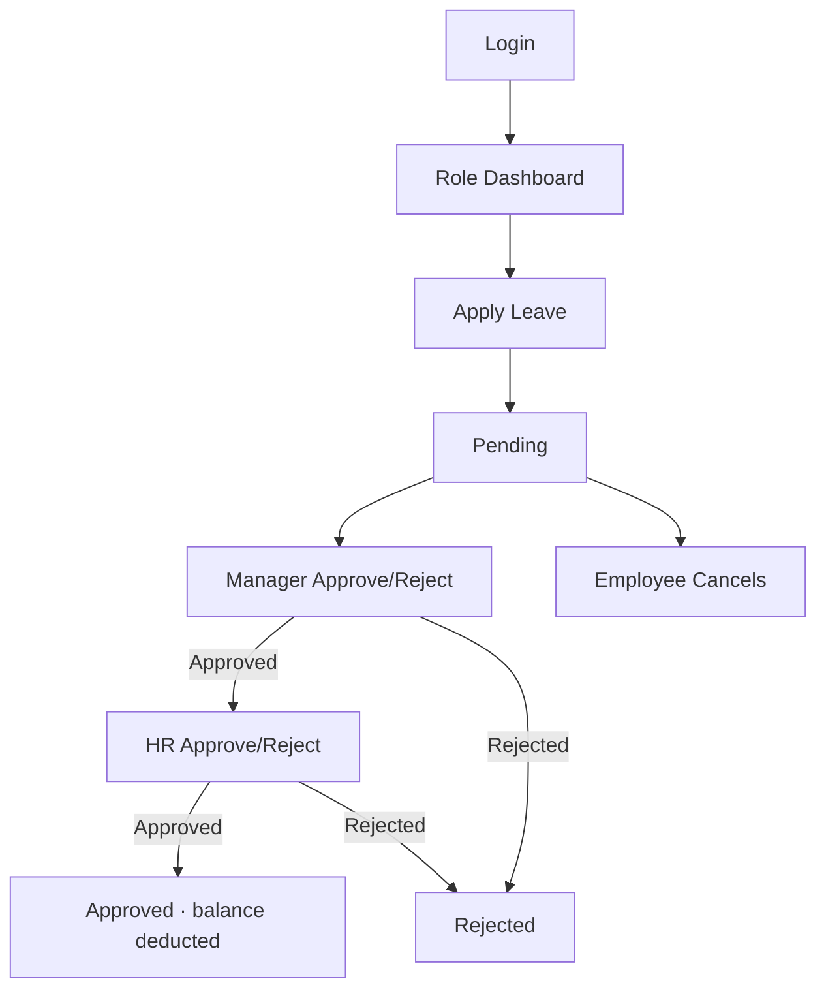

# UI Wireframes — Aganox LMS (Angular 18 + Bootstrap 5)

**Version:** 1.0  
**Fidelity:** Low–mid (structure & hierarchy, not final visual branding)

> Implementation note: Follow existing product branding when applied; avoid generic “AI purple” defaults. Wireframes below define **information architecture and flows**.

---

## 1. Global shell

```text
┌──────────────────────────────────────────────────────────────────────────┐
│ [Logo Aganox LMS]     Dashboard  Leave  Approvals  Employees  Reports    │
│                                                    👤 Name ▾  Logout     │
├───────────────┬──────────────────────────────────────────────────────────┤
│               │  Breadcrumb / Page title                    [Primary CTA]│
│  Side nav     │──────────────────────────────────────────────────────────│
│  (role-based) │                                                          │
│               │  Page content                                            │
│  • Overview   │                                                          │
│  • My Leave   │                                                          │
│  • Team       │                                                          │
│  • Admin      │                                                          │
│               │                                                          │
└───────────────┴──────────────────────────────────────────────────────────┘
```

- Top nav for primary modules; side nav for contextual section links.
- Collapse side nav on mobile (Bootstrap offcanvas).

---

## 2. Auth screens

### 2.1 Login

```text
┌─────────────────────────────┐
│         Aganox LMS          │
│     Leave Management        │
│                             │
│  Email    [..............]  │
│  Password [..............]  │
│  [ ] Remember me            │
│  [        Sign in         ] │
│  Forgot password?           │
└─────────────────────────────┘
```

### 2.2 Forgot / Reset / Change password

Single-column forms: email → token link → new password; Change Password from profile menu (current + new + confirm).

---

## 3. Dashboards (role-specific)

### 3.1 Employee

```text
┌──────────────┐ ┌──────────────┐ ┌──────────────┐
│ EL Remaining │ │ SL Remaining │ │ COMP Rem.    │
│    12.0      │ │     5.0      │ │    1.0       │
└──────────────┘ └──────────────┘ └──────────────┘

Upcoming leaves          Pending requests
─────────────────        ────────────────
15 Aug – 16 Aug EL       01 Sep SL (Pending)
...                      [Apply Leave]
```

### 3.2 Manager

```text
Pending approvals (count)     Team on leave today
[List: Emp | Type | Dates | Approve/Reject]

Team leave calendar (month grid)
Su Mo Tu We Th Fr Sa
·  ·  ·  A  A  ·  ·     A = teammate away
```

### 3.3 Admin / HR

```text
KPI row: Total Emp | Active | On leave today | Pending approvals

[Bar: leaves by department]   [Line: monthly trend]

Quick links: Employees · Leave types · Holidays · Reports · Backup
```

---

## 4. Employee management

### List

```text
Employees                              [+ Add Employee]
Search [____]  Dept [All▾] Status [All▾]   Sort: Name▾

┌────────┬──────────┬─────────┬────────────┬────────┬────────┐
│ Code   │ Name     │ Dept    │ Designation│ Manager│ Status │
├────────┼──────────┼─────────┼────────────┼────────┼────────┤
│ E001   │ A. Kumar │ Eng     │ Engineer   │ R. Shah│ Active │
└────────┴──────────┴─────────┴────────────┴────────┴────────┘
              « 1 2 3 »   Page size [10▾]
```

### Profile / Edit

Tabs: **Details** | **Leave balances** | **Leave history** | **Account**

Details: code, name, dept, designation, DOJ, email, phone, manager, status.  
Balances: editable opening/adjust (HR only).

---

## 5. Leave apply / edit

```text
Apply Leave
Leave type    [Earned Leave ▾]
From date     [2026-08-10]
To date       [2026-08-12]
[ ] Half day   Period [AM▾]     (enabled when from=to & type allows)
Days (auto)   3.0               (read-only; recalculates on change)
Remarks       [........................]

Validation messages (inline):
 · Overlaps existing leave
 · Insufficient balance
 · Weekend/holiday skipped notice

[Save Draft]  [Submit]
```

Status badge on view: Draft | Pending | Approved | Rejected | Cancelled  
Actions by status/role: Edit, Cancel, Approve, Reject.

---

## 6. Approvals inbox

```text
Approvals                    Filter: Pending▾
┌────────┬────────┬──────────┬───────────┬─────────────────────┐
│ Emp    │ Type   │ Dates    │ Days      │ Actions             │
├────────┼────────┼──────────┼───────────┼─────────────────────┤
│ Kumar  │ EL     │ 10–12 Aug│ 3.0       │ [View] [✓] [✗]      │
└────────┴────────┴──────────┴───────────┴─────────────────────┘

Detail drawer/page:
 Request summary · Balance snapshot · Timeline
 Approval history: Manager ✓ → HR (pending)
 Comment [____________] [Approve] [Reject]
```

---

## 7. Leave types & holidays (Admin/HR)

**Leave types:** table + modal (code, name, flags, sort, active).  
**Holidays:** calendar year picker + list/grid add/import.

---

## 8. Reports

```text
Reports
Report type [Employee Leave Report ▾]
Filters: From / To / Department / Employee / Leave type
[Generate]  Export: [Excel] [PDF] [CSV]

Results table / chart preview
```

---

## 9. Admin utilities

- Users & role assignment  
- Permissions matrix (role ↔ permission checkboxes)  
- Email settings / test  
- Backup now / restore upload  
- System settings (skip weekends default, company name)

---

## 10. Key user flows (wireflow)



---

## Approval checkpoint

Approve IA/navigation and leave apply UX before Angular scaffolding and visual design tokens.
