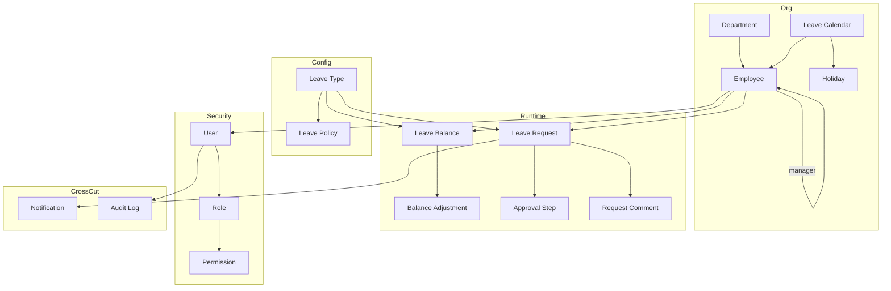
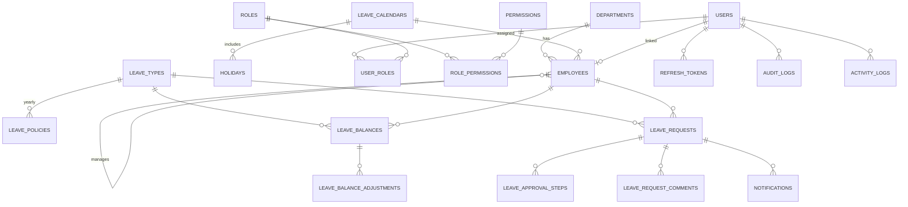
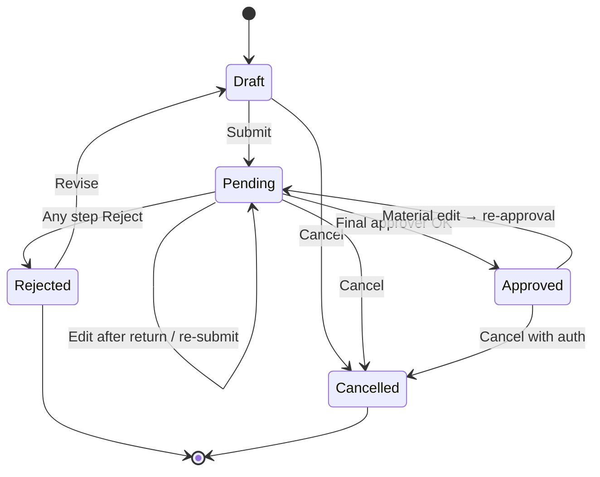

# ER Diagram — Aganox LMS

**Version:** 1.0  
**Companion:** [02-database-design.md](./02-database-design.md)

---

## 1. Conceptual model



---

## 2. Logical ER (normalized)



---

## 3. Entity cardinality cheat-sheet

| Entity A | Relation | Entity B |
|----------|----------|----------|
| Department | 1:N | Employee |
| Employee | 1:N | Employee (direct reports) |
| Employee | 1:0..1 | User |
| LeaveCalendar | 1:N | Holiday |
| LeaveType | 1:N | LeavePolicy (by year) |
| Employee + LeaveType + Year | 1:1 | LeaveBalance |
| LeaveBalance | 1:N | LeaveBalanceAdjustment |
| Employee | 1:N | LeaveRequest |
| LeaveRequest | 1:N | LeaveApprovalStep |
| Role | N:N | Permission |

---

## 4. Status state machine (LeaveRequest)



---

## 5. Approval chain (default)

```mermaid
sequenceDiagram
  participant E as Employee
  participant S as System
  participant M as Manager
  participant H as HR

  E->>S: Submit leave
  S->>S: Calc days, overlap, balance check
  S->>S: Create steps Manager→HR
  S->>M: Notify pending
  M->>S: Approve + comment
  S->>H: Notify pending
  H->>S: Approve + comment
  S->>S: Status=Approved; deduct balance
  S->>E: Notify approved
```

---

## Approval checkpoint

Approve ER and leave state machine; changes after coding start require migrations.
